# Piattaforma FAD per la formazione ECM

Piattaforma web completa per la **formazione a distanza** di professionisti sanitari: catalogo e vendita dei corsi,
videolezioni con tracciamento della fruizione, dirette in aula virtuale, lezioni in presenza con QR code, test,
questionari, attestati PDF e il consuntivo ECM da inviare all’ente accreditante (tracciato AGENAS).

Realizzata da zero per un ente di formazione. Questo repository è la **vetrina**: il codice sorgente è privato, ma
puoi provare tutto nella demo pubblica, con dati e persone inventati.

**[▶ Prova la demo](LINK_DEMO)** · nella pagina di accesso scegli un ruolo e sei dentro con un clic.

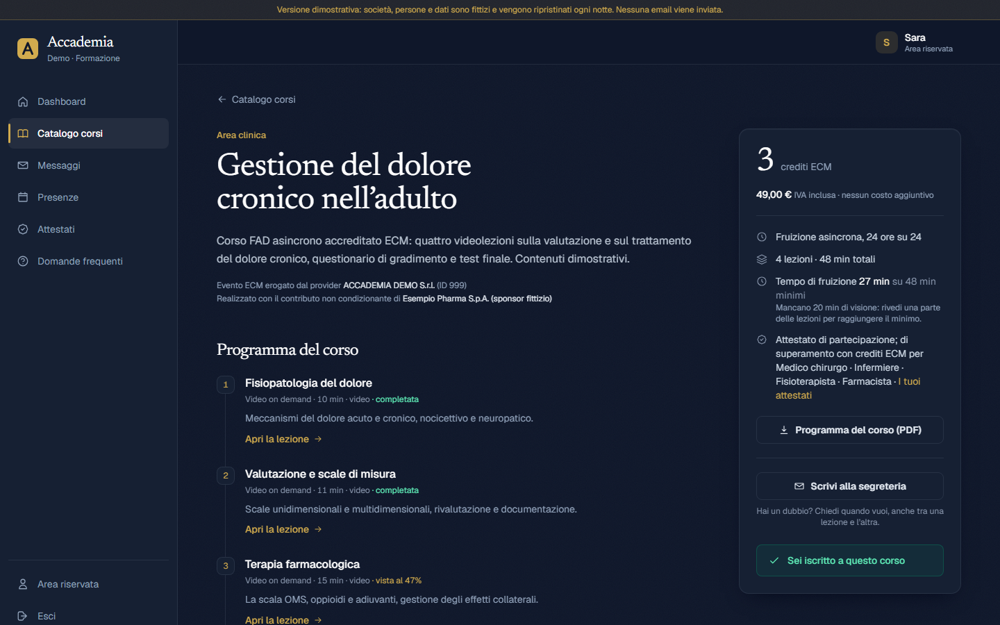

---

## Provala in 2 minuti

| Ruolo | Cosa guardare |
|---|---|
| **Discente** | apri il corso «Gestione del dolore cronico», riprendi la lezione 3 dal punto in cui era rimasta, scarica l’attestato del corso già concluso, esplora l’aula 3D |
| **Amministratore** | approva un ordine pagato con bonifico, guarda report e consuntivo ECM, il registro presenze di una lezione in aula |
| **Docente / Tutor / Moderatore** | i corsi assegnati, le domande dei discenti girate dalla segreteria, il registro presenze |

I dati vengono ripristinati ogni notte: puoi modificare, approvare e cancellare liberamente.
Il login classico funziona con password e codice OTP; nella demo le email non partono e il codice è `000000`.

## Cosa fa

**Per chi studia**
- Catalogo con corsi online, in diretta, in aula e misti; acquisto con PayPal o bonifico, coupon
- Videolezioni con **tempo minimo di fruizione**: alla prima visione non si salta avanti, controlli di presenza «Ci sei?» casuali, ripresa dal punto lasciato
- Dirette nell’**aula virtuale** (audio, video, schermo condiviso, chat, mano alzata, sottostanze)
- Lezioni in aula con **presenza tramite QR code** o codice numerico che cambia ogni minuto
- Questionario di gradimento anonimo, test finale con ordine casuale di domande e risposte
- **Attestati PDF** generati sul momento, con crediti ECM e codice di verifica
- **Aule 3D** esplorabili dal browser (Three.js) con schede degli oggetti e ricerca guidata
- Messaggi alla segreteria, che può girarli al docente

**Per chi gestisce**
- Corsi, lezioni, materiali, test importati da PDF, sponsor, coupon, numero massimo di posti
- Ordini da approvare, fatture, rimborsi, iscrizioni manuali
- Registri presenze con storico delle correzioni (chi, cosa, quando, perché) e convalida
- Report filtrabili ed esportabili (Excel/CSV) con registro delle esportazioni e impronta SHA-256
- **Consuntivo ECM in XML** conforme allo schema AGENAS, con controllo degli errori prima del download
- Ruoli separati: amministratore, amministratore in sola lettura, docente/relatore, tutor, moderatore
- Registro delle attività degli amministratori e degli accessi

## Scelte tecniche

- **Next.js 16 (App Router)**, React 19, Server Components e Server Actions; TypeScript ovunque
- **PostgreSQL + Prisma**: 39 modelli, 56 migrazioni scritte e versionate
- **Sicurezza**
  - login a due fattori (password + OTP via email)
  - sessioni con token casuale da 256 bit, salvato nel database solo come hash
  - limiti ai tentativi per IP e per account, risposte con tempi costanti contro l’enumerazione degli utenti
  - Content Security Policy restrittiva, nessun servizio di tracciamento
- **Privacy (GDPR)**: consenso ai cookie per servizio, questionari anonimi non collegabili al discente, cancellazione dei dati personali con conservazione di quelli imposti dalla legge, esportazione dei dati dell’utente
- **Integrazioni**: LiveKit (aula virtuale e registrazioni), Bunny Stream (video con link firmati a scadenza, caricamento riprendibile TUS), PayPal (ordini, webhook verificati, rimborsi), SMTP
- **PDF** generati sul server con pdf-lib (attestati, registri, test); backup cifrati con rotazione e verifica
- **Test automatici**: 303 test con `node:test` sulle regole più delicate (fruizione, crediti, consuntivo, permessi)
- **Accessibilità**: navigazione da tastiera, contrasti e focus curati (WCAG 2.1 AA come obiettivo)
- Circa 44.000 righe di TypeScript, 60 pagine e 22 API

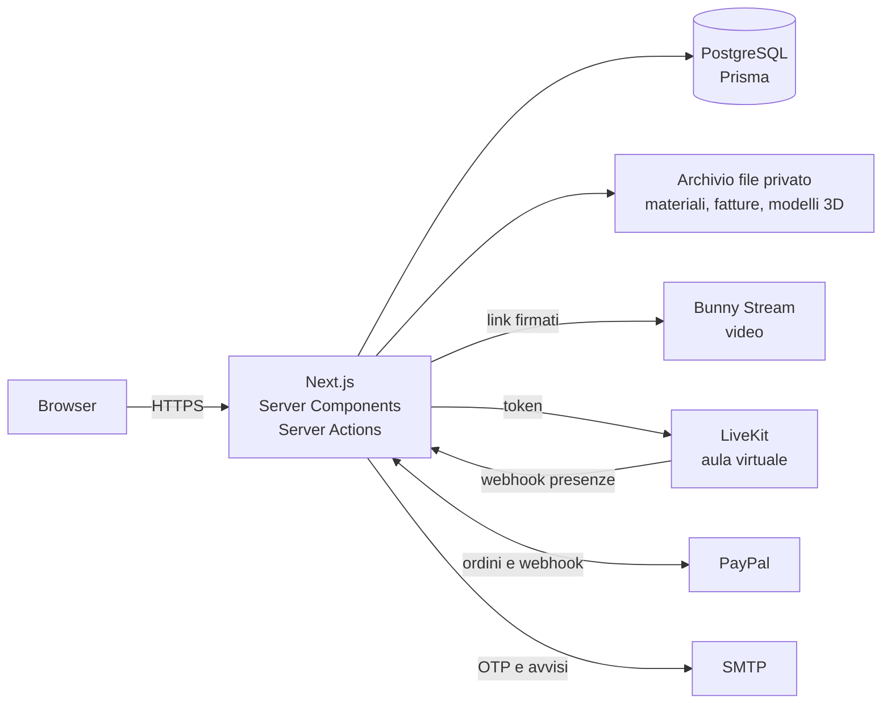

## Schermate

| | |
|---|---|
| 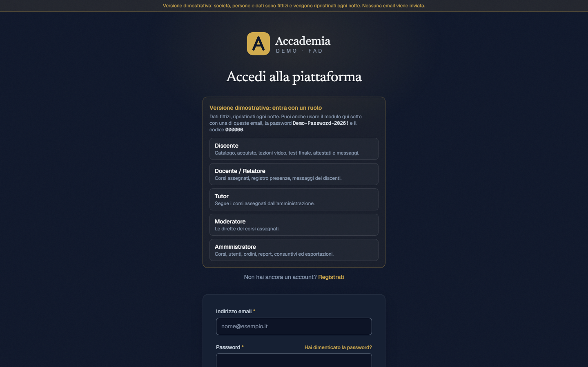 Accesso (demo con un clic) | 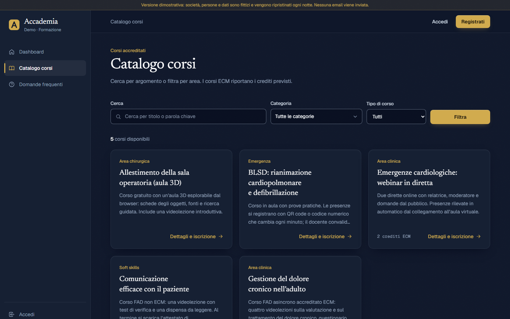 Catalogo corsi |
| 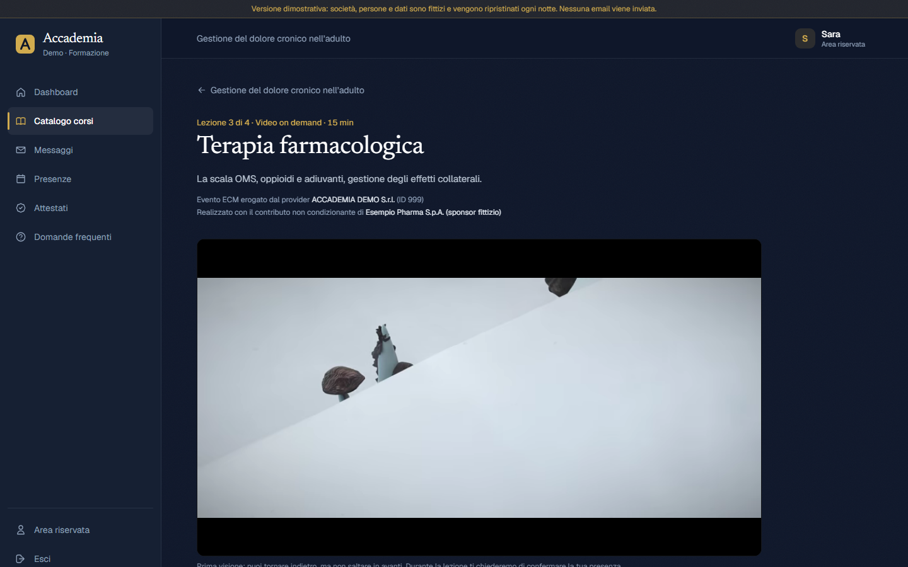 Videolezione con tracciamento | 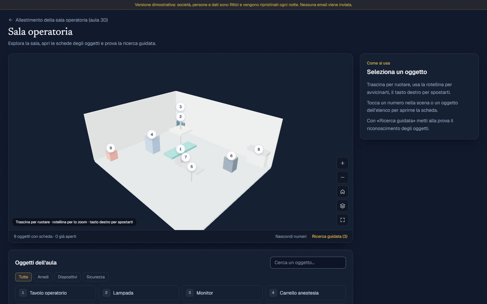 Aula 3D |
| 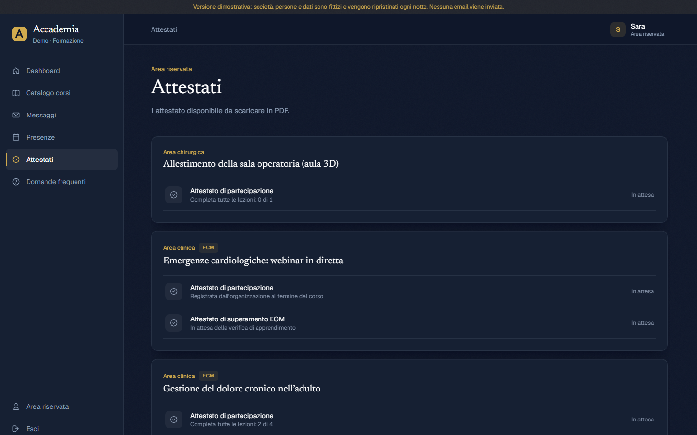 Attestati | 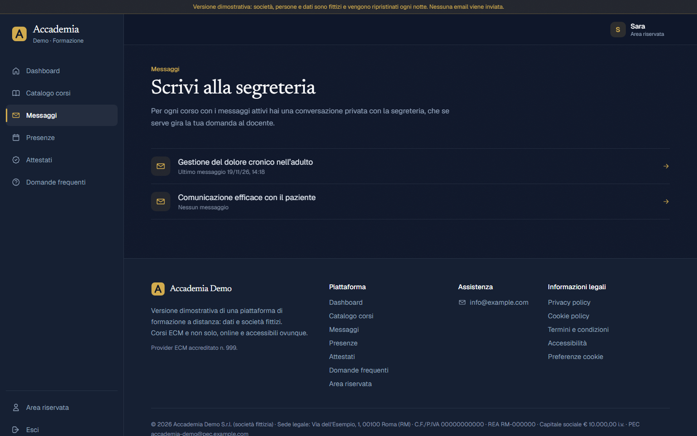 Messaggi alla segreteria |
| 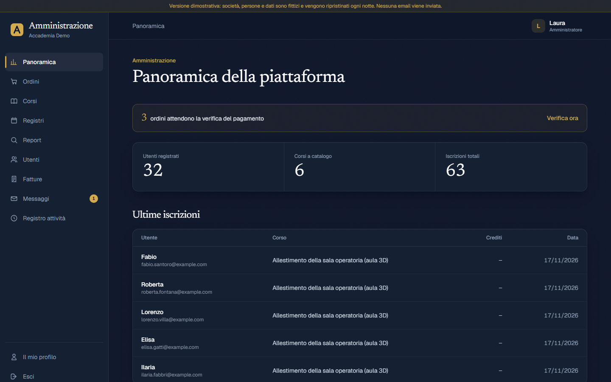 Panoramica amministratore | 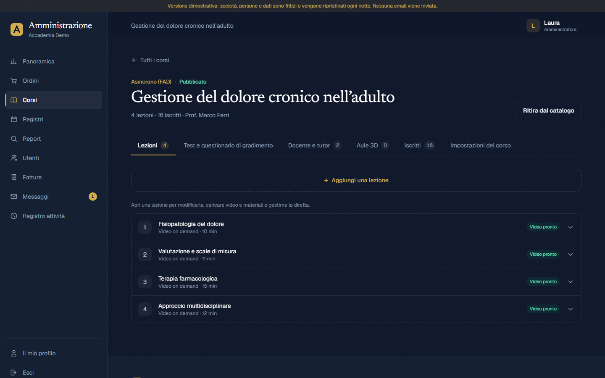 Gestione del corso |
| 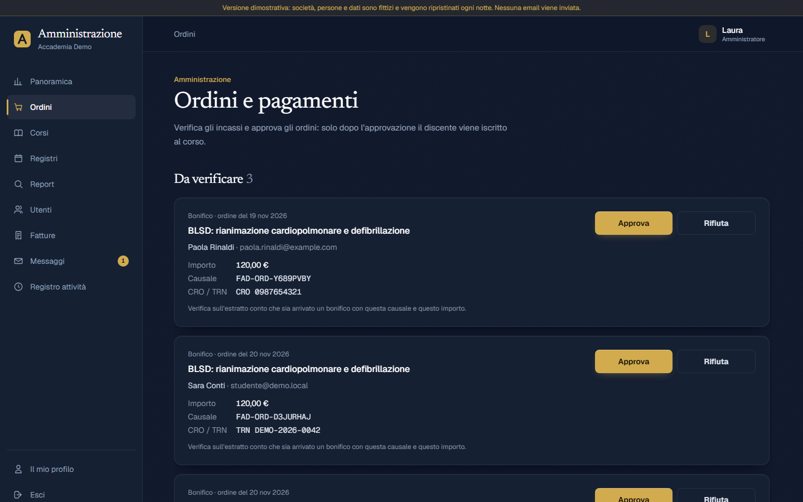 Ordini da approvare | 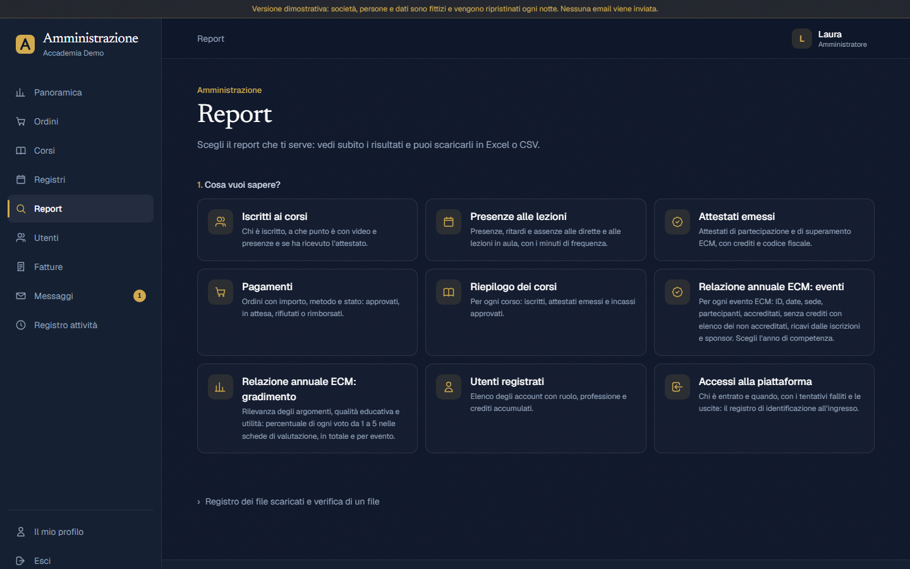 Report |
| 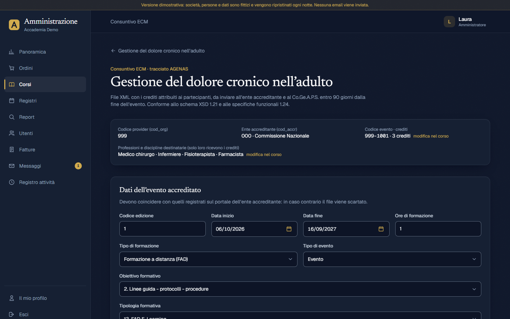 Consuntivo ECM (XML AGENAS) | 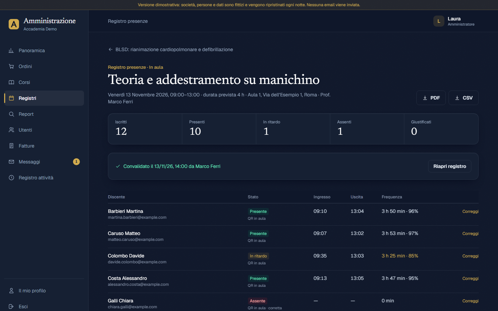 Registro presenze |
| 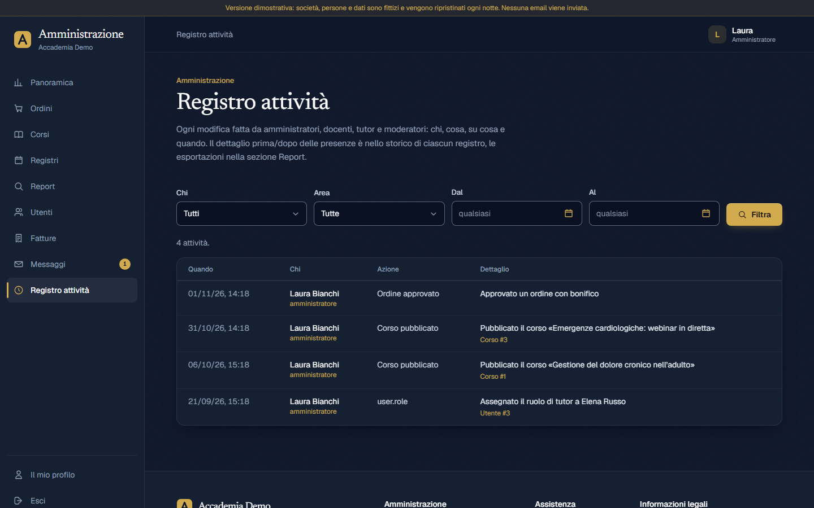 Registro attività | 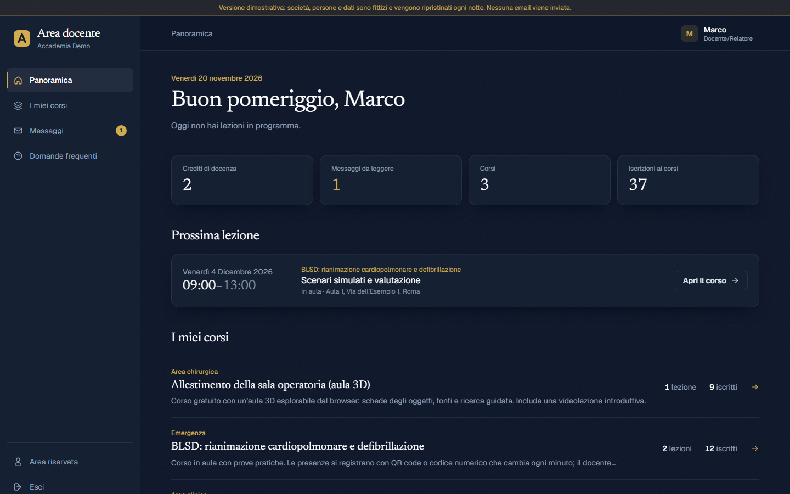 Area docente |

  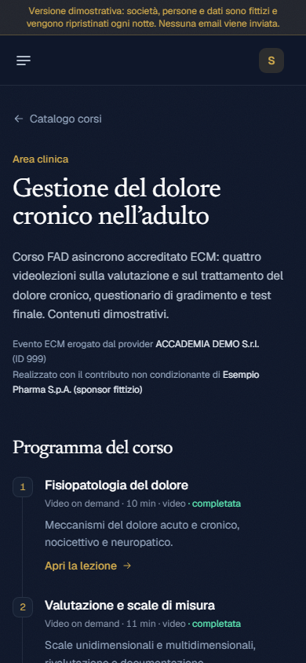
  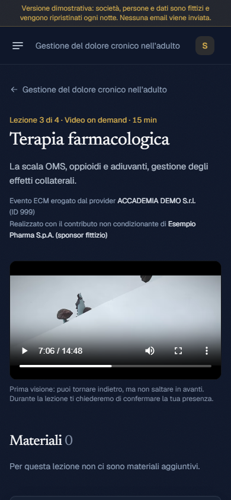

## Note sulla demo

- Società, persone, numeri di accreditamento e sponsor sono **inventati**; gli attestati portano la scritta «FAC-SIMILE DIMOSTRATIVO».
- I video sono cortometraggi della Blender Foundation (*Big Buck Bunny*, *Elephants Dream*, *Sintel*, *Tears of Steel*), licenza Creative Commons Attribuzione, serviti da Wikimedia Commons.
- La demo gira su servizi gratuiti (Vercel e Neon): il primo caricamento dopo un periodo di inattività può richiedere qualche secondo.
- L’aula virtuale in diretta richiede un server LiveKit e nella demo potrebbe non essere attiva.

## Codice sorgente

Il codice è privato perché il progetto è stato realizzato per un cliente. Posso mostrarlo e spiegarlo durante
un colloquio tecnico.
